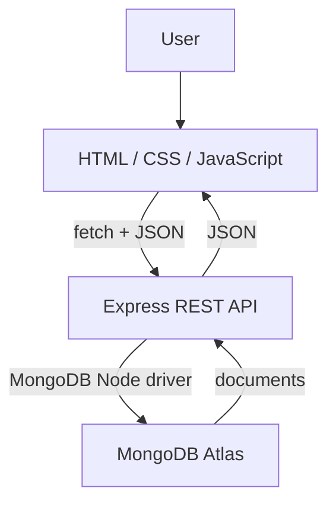

# Fullstack Brain Bucket
> A student directory that saves your records, majors, and notes in MongoDB.

`@ltortorigi` | `2026-10-01` | `HOTEL`

## Deployments + codebase

| Resource | Direct link |
| --- | --- |
| PROD code | [main](https://github.com/ltortorigi/fullstack-brain-bucket/tree/main) |
| PROD application | [GCP application](https://logan.barrycumbie.com/) |
| DEV code | [dev](https://github.com/ltortorigi/fullstack-brain-bucket/tree/dev) |
| DEV application | [Render application](https://fullstack-brain-bucket-dj2n.onrender.com/) |
| Documentation | [Published docs](https://ltortorigi.github.io/fullstack-brain-bucket/) · [source](https://github.com/ltortorigi/fullstack-brain-bucket/blob/dev/docs/README.md) |
| CI/CD | [Tests](https://github.com/ltortorigi/fullstack-brain-bucket/blob/dev/.github/workflows/test.yml) · [GCP deployment](https://github.com/ltortorigi/fullstack-brain-bucket/blob/dev/.github/workflows/deploy-main-to-gcp.yml) |

## HOTEL grading dashboard

| Requirement | Evidence |
| --- | --- |
| MongoDB Atlas connection | [MongoDB driver, environment config, connection + ping](https://github.com/ltortorigi/fullstack-brain-bucket/blob/dev/server/mongo.js) |
| GET all | [GET /api/students](https://github.com/ltortorigi/fullstack-brain-bucket/blob/dev/server/routes.js#L55) |
| GET one by identifier | [GET /api/students/:id and ObjectId validation](https://github.com/ltortorigi/fullstack-brain-bucket/blob/dev/server/routes.js#L73) |
| Filtered GET | [GET /api/students?major=CIS](https://github.com/ltortorigi/fullstack-brain-bucket/blob/dev/server/routes.js#L55) |
| POST / create | [POST /api/students](https://github.com/ltortorigi/fullstack-brain-bucket/blob/dev/server/routes.js#L80) |
| PATCH / update | [PATCH /api/students/:id](https://github.com/ltortorigi/fullstack-brain-bucket/blob/dev/server/routes.js#L88) |
| DELETE | [DELETE /api/students/:id](https://github.com/ltortorigi/fullstack-brain-bucket/blob/dev/server/routes.js#L94) |
| Frontend fetch + DOM updates | [Client JavaScript](https://github.com/ltortorigi/fullstack-brain-bucket/blob/dev/public/assets/js/hotel.js) · [HTML](https://github.com/ltortorigi/fullstack-brain-bucket/blob/dev/public/hotel.html) |
| Persistent CRUD | [Real MongoDB integration tests](https://github.com/ltortorigi/fullstack-brain-bucket/blob/dev/server/test/api.test.js); [17 automated tests passed](https://github.com/ltortorigi/fullstack-brain-bucket/actions/runs/36939379402); [live DEV verification](https://github.com/ltortorigi/fullstack-brain-bucket/blob/dev/docs/VERIFICATION.md) |
| Secrets excluded from Git | [.gitignore](https://github.com/ltortorigi/fullstack-brain-bucket/blob/dev/.gitignore) · [blank environment template](https://github.com/ltortorigi/fullstack-brain-bucket/blob/dev/server/.env.example) |
| HOTEL milestone | [Milestones](https://github.com/ltortorigi/fullstack-brain-bucket/milestones) — HOTEL assigned to issue #2 |
| Feature issue | [Issue #2](https://github.com/ltortorigi/fullstack-brain-bucket/issues/2) |
| Development branch | [hotel/student-crud](https://github.com/ltortorigi/fullstack-brain-bucket/tree/hotel/student-crud) |
| Feature → dev | [PR #3 — merged into dev](https://github.com/ltortorigi/fullstack-brain-bucket/pull/3) |
| dev → main | [PR #4 — merged into main](https://github.com/ltortorigi/fullstack-brain-bucket/pull/4) |
| Successful HOTEL PROD deployment | [Successful HOTEL GCP deployment (Oct 10, 2026)](https://github.com/ltortorigi/fullstack-brain-bucket/actions/runs/38094394447) |

## Current verification status

- HOTEL implementation is merged into `main` through [PR #4](https://github.com/ltortorigi/fullstack-brain-bucket/pull/4), following [PR #3](https://github.com/ltortorigi/fullstack-brain-bucket/pull/3) into `dev`.
- [Automated HOTEL tests passed](https://github.com/ltortorigi/fullstack-brain-bucket/actions/runs/38094394448). The test suite includes API, frontend, and connection diagnostics.
- Render DEV passed live MongoDB CRUD verification on October 1, 2026. See [DEV verification](VERIFICATION.md).
- GCP PROD successfully deployed through [GitHub Actions (attempt 4, October 10, 2026)](https://github.com/ltortorigi/fullstack-brain-bucket/actions/runs/38094394447).
- GCP VM `main` branch, PM2, local `/api/health`, public HTTPS `/api/health`, and MongoDB connection all passed verification on October 10, 2026. GET `/api/students` returned an existing record.
- [HOTEL milestone](https://github.com/ltortorigi/fullstack-brain-bucket/milestones) is assigned to [issue #2](https://github.com/ltortorigi/fullstack-brain-bucket/issues/2), which is closed.
- **Remaining verification:** Confirm full create → read → update → refresh → delete sequence on PROD and review the reported npm critical dependency vulnerability. Do not claim these checks completed without evidence.

## Use the app

1. Enter a name and major, then choose **Add student**.
2. Use **Filter** for an exact major (case-sensitive), or **Show all**.
3. Choose **View** to fetch one record by its ID, **Edit** to update it, or **Delete** to remove it.
4. Refresh the page to confirm records persist. **Find a student by ID** also supports a pasted MongoDB identifier.
5. Expand **API activity** to inspect the latest JSON response.

The directory is a classroom CRUD demo without authentication. Use fictional sample records.

## Architecture

Development flow: issue → feature branch → PR → dev → DEV test → PR → main → GitHub Actions → GCP / PM2 / Nginx.

Stack: HTML/CSS/JavaScript, Bootstrap 5, Bootstrap Icons, Node.js, Express 5, MongoDB Node.js Driver, Atlas, Git/GitHub, Render, GCP, PM2, Nginx, GitHub Actions.

## Setup + verification

See [SETUP.md](https://github.com/ltortorigi/fullstack-brain-bucket/blob/main/docs/SETUP.md) for local, Render, and GCP setup, API examples, and the final deployment checklist.

The previous Brain Bucket idea-board files remain in `public/asdindex.html`, `public/pages/`, and `public/assets/`. The HOTEL directory is served at `/`, `/index.html`, and `/hotel.html`.
