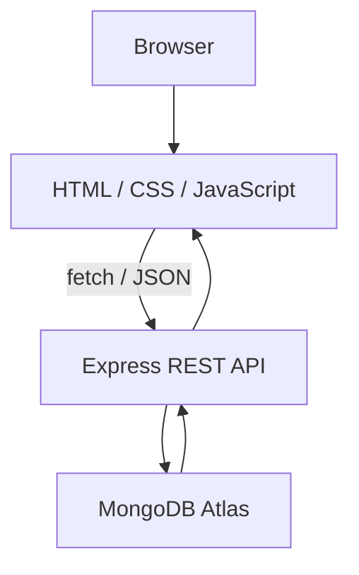

# Fullstack Brain Bucket — HOTEL

> Hat Collection: a basic CRUD webpage for saving hat colors and styles in MongoDB.

`@ltortorigi` | `2026-10-13` | `HOTEL`

## Deployments and codebase

| Resource | Direct link |
| --- | --- |
| PROD application | [GCP app](https://logan.barrycumbie.com/) |
| DEV application | [Render app](https://fullstack-brain-bucket-dj2n.onrender.com/) |
| PROD branch | [main](https://github.com/ltortorigi/fullstack-brain-bucket/tree/main) |
| DEV branch | [dev](https://github.com/ltortorigi/fullstack-brain-bucket/tree/dev) |
| Frontend | [HTML](https://github.com/ltortorigi/fullstack-brain-bucket/blob/main/public/hotel.html) · [JavaScript](https://github.com/ltortorigi/fullstack-brain-bucket/blob/main/public/assets/js/hotel.js) · [CSS](https://github.com/ltortorigi/fullstack-brain-bucket/blob/main/public/assets/css/hotel.css) |
| Backend | [Express routes](https://github.com/ltortorigi/fullstack-brain-bucket/blob/main/server/routes.js) · [MongoDB connection](https://github.com/ltortorigi/fullstack-brain-bucket/blob/main/server/mongo.js) |
| Documentation | [Published GitHub Pages](https://ltortorigi.github.io/fullstack-brain-bucket/) · [README](https://github.com/ltortorigi/fullstack-brain-bucket/blob/main/README.md) |
| CI/CD | [GitHub Actions](https://github.com/ltortorigi/fullstack-brain-bucket/actions) · [GCP workflow](https://github.com/ltortorigi/fullstack-brain-bucket/blob/main/.github/workflows/deploy-main-to-gcp.yml) |

## HOTEL grading dashboard

| Requirement | Evidence |
| --- | --- |
| MongoDB Atlas | [MongoDB connection and ping](https://github.com/ltortorigi/fullstack-brain-bucket/blob/main/server/mongo.js) |
| GET all | [GET /api/students](https://github.com/ltortorigi/fullstack-brain-bucket/blob/main/server/routes.js) |
| GET by ID | [GET /api/students/:id](https://github.com/ltortorigi/fullstack-brain-bucket/blob/main/server/routes.js) |
| Filtered GET | [GET /api/students?major=Baseball%20Cap](https://github.com/ltortorigi/fullstack-brain-bucket/blob/main/server/routes.js) |
| POST / create | [POST /api/students](https://github.com/ltortorigi/fullstack-brain-bucket/blob/main/server/routes.js) |
| PATCH / update | [PATCH /api/students/:id](https://github.com/ltortorigi/fullstack-brain-bucket/blob/main/server/routes.js) |
| DELETE | [DELETE /api/students/:id](https://github.com/ltortorigi/fullstack-brain-bucket/blob/main/server/routes.js) |
| Frontend fetch and DOM | [Client script](https://github.com/ltortorigi/fullstack-brain-bucket/blob/main/public/assets/js/hotel.js) |
| Automated testing | [Frontend test](https://github.com/ltortorigi/fullstack-brain-bucket/blob/main/server/test/frontend.test.js) · [API tests](https://github.com/ltortorigi/fullstack-brain-bucket/blob/main/server/test/api.test.js) |
| Secrets kept out of Git | [.gitignore](https://github.com/ltortorigi/fullstack-brain-bucket/blob/main/.gitignore) · [.env.example](https://github.com/ltortorigi/fullstack-brain-bucket/blob/main/server/.env.example) |
| HOTEL milestone | [Milestones](https://github.com/ltortorigi/fullstack-brain-bucket/milestones) |
| Feature issue | [Issue #2](https://github.com/ltortorigi/fullstack-brain-bucket/issues/2) |
| Feature branch | [hotel/student-crud](https://github.com/ltortorigi/fullstack-brain-bucket/tree/hotel/student-crud) (original implementation) |
| Feature → dev | [PR #3](https://github.com/ltortorigi/fullstack-brain-bucket/pull/3) |
| dev → main | [PR #4](https://github.com/ltortorigi/fullstack-brain-bucket/pull/4) |
| Hat page → main | [PR #6](https://github.com/ltortorigi/fullstack-brain-bucket/pull/6) |
| Deployment history | [GitHub Actions runs](https://github.com/ltortorigi/fullstack-brain-bucket/actions) |

## How to use the Hat Collection

1. Type **Hat Color**, such as **Black**.
2. Type **Hat Style**, such as **Baseball Cap**.
3. Click **Add hat**.
4. Use **View**, **Edit**, and **Delete** to manage the saved hats.
5. Use the style filter or **Show all**; refresh to check that data persists.
6. Optionally look up a hat by its MongoDB record ID or expand **API activity** to see JSON responses.

Only two fields are shown on the form. For compatibility with the existing API, **hat color is stored as `name` and hat style as `major`**, with `notes` empty for newly submitted hats. Existing internal `/api/students` routes and database collection names are retained intentionally.

## Verification and deployment history

- The original student-directory implementation passed automated tests and DEV CRUD verification in October 2026. [Earlier verification record](VERIFICATION.md).
- The original HOTEL PROD deployment succeeded on October 10, 2026: [deployment run](https://github.com/ltortorigi/fullstack-brain-bucket/actions/runs/38094394447).
- The Hat Collection interface was merged into `main` through [PR #6](https://github.com/ltortorigi/fullstack-brain-bucket/pull/6).
- The frontend tests were updated to match the Hat Collection form after an initial test failure.
- **October 13, 2026:** The project owner reports the latest production deployment succeeded. This statement is based on the owner's confirmation; a separate live CRUD round-trip for the hat form has not been documented here.
- [HOTEL issue #2](https://github.com/ltortorigi/fullstack-brain-bucket/issues/2) and the HOTEL milestone provide project tracking.

## Architecture

Workflow: issue → feature branch → PR → dev → DEV testing → PR → main → GitHub Actions → GCP.

Stack: HTML, CSS, JavaScript, Bootstrap, Node.js, Express, MongoDB Atlas, Render, GCP, PM2, Nginx, GitHub Actions.

## Setup and testing

See [SETUP.md](SETUP.md) for local setup, deployment configuration, API examples, and checks. The application is served at `/`, `/index.html`, and `/hotel.html`.

This is a classroom CRUD demo without user authentication. Use fictional sample records, not sensitive personal information.
